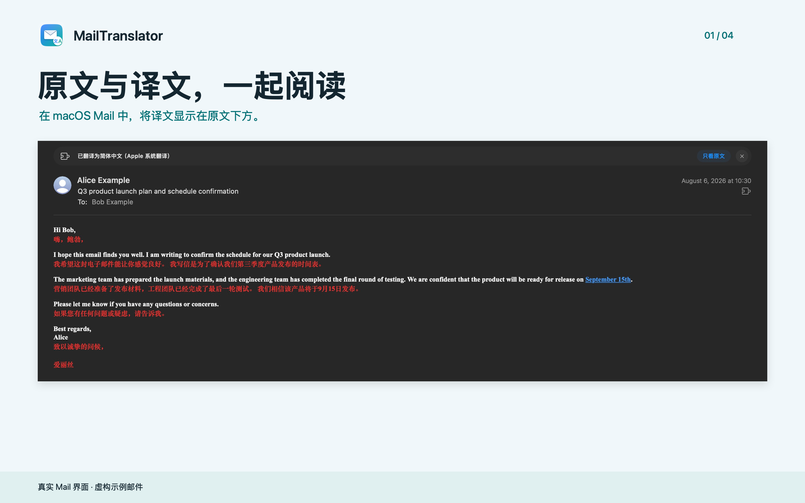
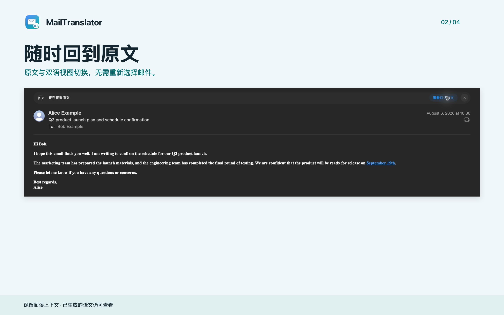

  

# MailTranslator

**在 Apple Mail 中读懂每一封邮件。**

**Read both languages, right inside Apple Mail.**

[简体中文](#简体中文) · [English](#english) · [隐私政策 / Privacy](docs/privacy-policy.md) · [支持 / Support](https://github.com/AllenYGY/MailTranslator/issues)

## 简体中文

MailTranslator 是原生 macOS 邮件翻译扩展。译文渐进显示在邮件原文下方，不必复制正文或切换应用。

- **双语对照**：保留原文，在同一封邮件内阅读译文。
- **阅读不中断**：支持停止、继续翻译，以及“只看原文”。
- **Apple 系统翻译**：无需 API Key，无需配置第三方翻译账户。
- **无订阅**：主动领取 7 天完整免费试用；一次性永久解锁，中国大陆定价人民币 6 元。实际价格以当地 App Store 为准。

试用通过应用内免费领取开始，不会自动扣款或续费。重新安装或恢复购买不会重置试用期限。

### 开始使用

需要 **macOS 26 或更高版本**以及 Apple Mail，支持的语言组合以 Apple 系统翻译为准。

1. 在“系统设置 > 通用 > 语言与地区 > 翻译语言”下载源语言和目标语言。
2. 打开 MailTranslator，选择目标语言并保存。
3. 在“Mail > 设置 > 扩展”启用 MailTranslator，然后打开邮件并点击翻译。

### 获取与支持

本仓库仅用于产品介绍、隐私政策和问题反馈，**不再提供源码、GitHub Release 或 Homebrew 安装包**。Mac App Store 的实际可用性及价格以商店页面为准。

[查看 App Store](https://apps.apple.com/app/id6821313136) · [问题反馈](https://github.com/AllenYGY/MailTranslator/issues) · [隐私政策](docs/privacy-policy.md)

请勿在公开反馈中附上私人邮件、购买凭证或其他敏感信息。

## English

MailTranslator is a native macOS Mail extension. Translations appear progressively below the original message, without copying text or switching apps.

- **Bilingual reading**: keep the original and translation together.
- **Stay in control**: stop, continue, or switch to the original-only view.
- **Apple Translation**: no API keys or third-party translation accounts.
- **No subscription**: explicitly claim a full 7-day free trial, then choose a one-time permanent unlock. China mainland price: CNY 6; your local App Store price applies.

The trial never automatically becomes a paid purchase and does not renew. Reinstalling or restoring purchases does not restart it.

### Get Started

Requires **macOS 26 or later**, Apple Mail, and a language pair supported by Apple Translation.

1. Download both languages in **System Settings > General > Language & Region > Translation Languages**.
2. Open MailTranslator, select your target language, and save.
3. Enable MailTranslator in **Mail > Settings > Extensions**, then translate a message.

### Availability and Support

This repository contains product information, the privacy policy, and support only. **Source code, GitHub Releases, and Homebrew downloads are no longer distributed here.** Availability and pricing are determined by the Mac App Store listing.

[View on the App Store](https://apps.apple.com/app/id6821313136) · [Get support](https://github.com/AllenYGY/MailTranslator/issues) · [Privacy policy](docs/privacy-policy.md)

Do not include private messages, purchase receipts, or other sensitive information in public issues.

